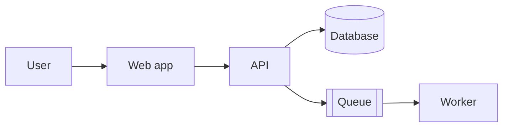
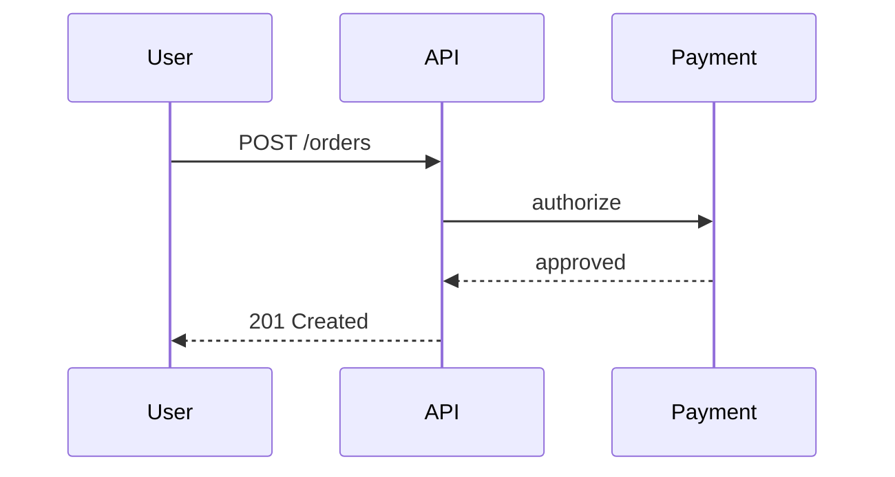
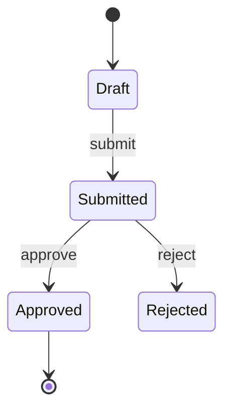
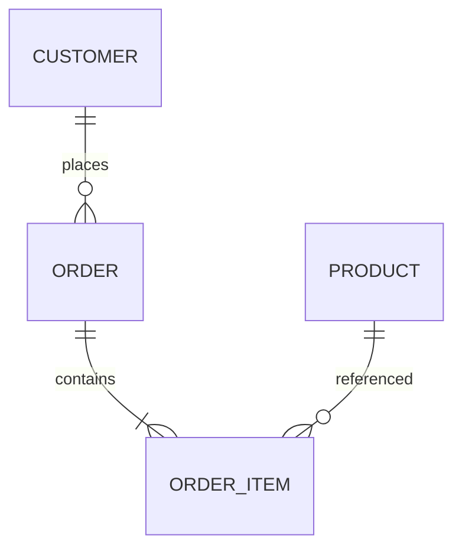

# Diagrams

Diagrams explain structure and flow faster than prose. Keep them **as code** (Mermaid, PlantUML, D2) so they are versioned, reviewable, and diffable.

## When to use a diagram

- The architecture has more than three components.
- A request/event flow crosses several services.
- A state machine has non-obvious transitions.
- A data model has relationships that are hard to describe in a table.
- Onboarding needs a map of the system.

Do not diagram a single function or an obvious CRUD flow.

## C4 model

Use C4 levels to avoid mixing audiences:

| Level | Shows | Audience |
|-------|-------|----------|
| **Context** | System + users + external systems | Everyone |
| **Container** | Apps, services, databases, queues | Technical |
| **Component** | Modules inside a container | Developers |
| **Code** | Classes/functions (rarely worth it) | Developers |

Start at Context; add Container only when it answers a real question.

## Mermaid examples

### Flow

### Sequence

### State

### ER

## Rules

- **One question per diagram**: context, flow, state, or data. Do not mix.
- **Label the arrows** with the action/event.
- **Use consistent names** with the code and docs.
- **Keep it small**; split a diagram that needs scrolling.
- **Store it next to the docs** (`docs/architecture/`, `docs/diagrams/`).
- **Update it in the same PR** that changes the architecture.
- **Add a caption** explaining what the reader should notice.
- **Provide a text alternative** for accessibility (a short summary).

## Review checklist

- [ ] The diagram answers one question.
- [ ] Nodes/edges use domain names.
- [ ] Arrows are labeled.
- [ ] External systems are marked.
- [ ] It matches the current code.
- [ ] It is linked from the README/architecture doc.
- [ ] It renders in the target viewer (GitHub/GitLab/docs site).

## Anti-patterns

| Anti-pattern | Problem | Fix |
|---|---|---|
| Diagram with every class | Unreadable | Use C4 Context/Container |
| Unlabeled arrows | Ambiguous flow | Label actions/events |
| Screenshot of a diagram | Not diffable | Use Mermaid/PlantUML |
| Stale diagram | Misleading | Update with the code |
| Mixing levels | Confusing | One C4 level per diagram |
| Decorative icons | Noise | Keep it semantic |
