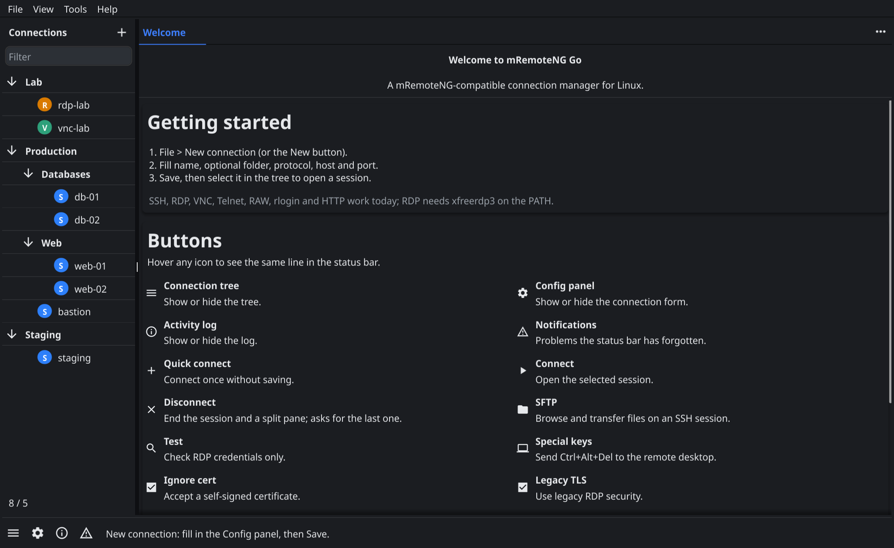
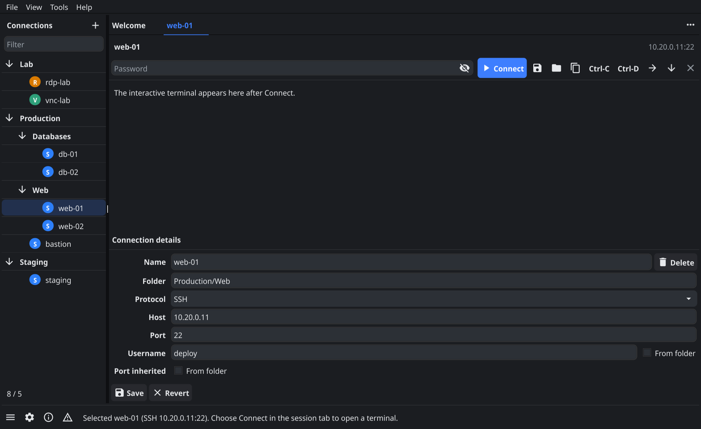
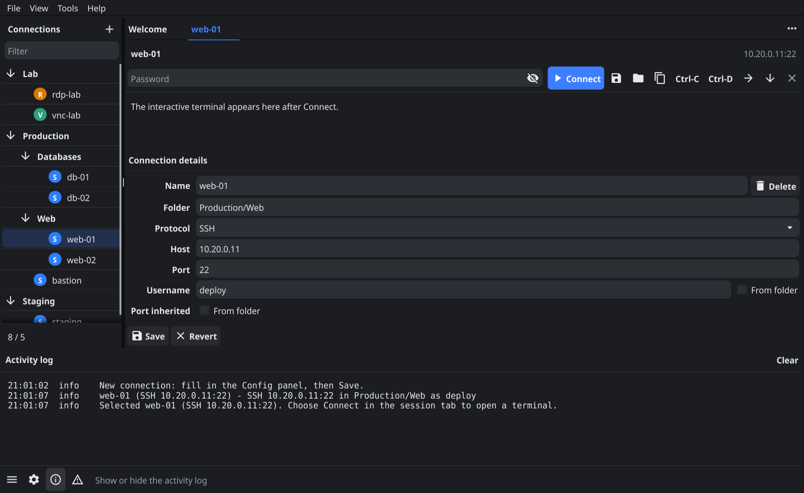

# mRemoteNG Go

[](https://github.com/gigakas/mremoteng-go/actions/workflows/ci.yml)
[](https://github.com/gigakas/mremoteng-go/actions/workflows/package-linux.yml)

A Go implementation of the [mRemoteNG](https://github.com/mRemoteNG/mRemoteNG)
connection manager, built Linux-first: one window in which SSH, RDP, VNC,
Telnet, RAW, rlogin, HTTP and serial connections live in tabs, next to the
connection tree and the Config panel the original application is known for.

The interface is written in Go with [Fyne](https://fyne.io); there is no .NET,
C# or Mono dependency. The palette is restrained and dark, with a light variant,
compact type and a single accent colour for the primary action.

**Status: Linux preview.** Profiles, folders, import/export, the credential
vault and live sessions work today; the packaging scripts build a tarball, a
Debian package, an rpm and a Flatpak bundle. The active stage table is
[`blueprint/linux-preview.md`](blueprint/linux-preview.md) and every change is
listed in [`CHANGELOG.md`](CHANGELOG.md).

## Contents

- [Screenshots](#screenshots)
- [Features](#features)
- [Protocol support](#protocol-support)
- [Requirements](#requirements)
- [Install](#install)
- [Build and run](#build-and-run)
- [Configuration and data](#configuration-and-data)
- [Keyboard and mouse](#keyboard-and-mouse)
- [Security notes](#security-notes)
- [Releases and continuous integration](#releases-and-continuous-integration)
- [Project layout](#project-layout)
- [Development](#development)
- [Known limitations](#known-limitations)

## Screenshots

The main window: the connection tree on the left, the session tabs on the right
and a status bar whose icons toggle the activity log, the notifications panel
and the Config panel.



Selecting a connection opens its tab and fills the Config panel, titled
*Connection details*, with the saved values; Save and Revert sit at the bottom
and Delete belongs to the connection name.



Every status message is timestamped and kept in the activity log, so a line the
status bar has already replaced is still there.



## Features

### Connections, folders and the tree

- Narrow (15%), collapsible connection tree with folders addressed by path
  (`Production/Web`), a filter box and expand/collapse from flat status-bar
  icons or the View menu. Folders persist even while empty, can be renamed
  (rewriting the Folder value of every connection below them) and deleted with
  confirmation (their connections and tabs go too).
- Rows carry a circular SSH/RDP badge and report the full name and endpoint in
  the status bar on hover; the footer counts `connections / folders`.
- Right-click a row for its context menu. A connection's menu offers Rename,
  Open, **Move to** (root and every folder), Move up/down and Delete; a folder's
  menu adds *Folder defaults* and *New folder inside*. Connections can also be
  dragged onto a folder row, and dropped elsewhere to return to the root.
- **Folder defaults**: a folder can share a username and port; connections opt
  in with the *From folder* toggles in the Config panel, and sessions use the
  resolved values.
- **Manual order**: Move up/down in the row menu arranges the tree the way you
  want it, and the order survives a restart.

### Connection details

- The Config panel holds name, folder, protocol, host, port and username, plus
  the protocol's own fields (serial line settings, RDP redirection options).
  Save and Revert are at the bottom, Delete next to the name.
- Validation rejects missing or ambiguous values — `host:port`, `ssh://`
  prefixes and `-`-prefixed fields, which would be unsafe once passed to an
  external client.
- The panel is hidden until you create or select a connection and can be toggled
  at any time with the settings icon in the status bar or View > Toggle Config
  panel. It hides while a session is active so the session gets the full height.
- Unsaved edits are protected when you switch connections, start a new one or
  close the window.

### Sessions

- One tab per opened connection, each with a connection bar (name, endpoint,
  password field, Connect/Disconnect, SFTP, special keys, Ctrl-C/Ctrl-D and
  close) above the session itself.
- **Split panes**: View > Split pane right/down and Close pane divide a tab into
  a group of sessions; the split shape is stored per tab and comes back on
  restart. The X in a pane's bar ends that pane's session and closes the pane; it
  asks first only when it would close the last session of the tab.
- **Quick connect** (sidebar icon or File menu) opens an ad-hoc SSH, RDP or VNC
  session that never writes a profile; the status bar says it is temporary.
- **Terminal**: a VT100/xterm emulator with 256 colours, a 2000-line scrollback,
  mouse-wheel scrolling, drag-to-select, double-click for a line, right-click
  copy and per-tab zoom (8-28 pt) with Ctrl+=, Ctrl+- and Ctrl+0. The window
  resize reaches the remote PTY.
- **Remote files (SFTP)**: a two-pane transfer window, local on the left and the
  remote host on the right, each pane listing a directory with folder and file
  icons, a name filter, sortable headers, upload/download with progress, rename,
  delete and new folder.
- **Credentials, typed or stored**: a session uses the password you type for that
  attempt, or the secret in the vault when the field is empty. Nothing is written
  to the profile.
- **Restored tabs**: the tabs of the last session come back (when the preference
  is on) unconnected, with their split layout, so each pane waits for its own
  Connect.

### Workspace, import and tools

- **Workspace memory**: window size and position, collapsed folders, the open
  tabs, the active tab and the split layouts survive a restart.
- **Settings** (File > Settings): colour variant (system/light/dark), the
  protocol and port a new connection starts with, and whether the last tabs are
  reopened.
- **Import/export**: mRemoteNG XML (2.6, 2.7, 2.8) and CSV, with a preview of
  connections, folders, skipped rows and dropped passwords, then Merge or
  Replace. The source file is only read; export writes XML (optionally
  password-protected) or CSV.
- **Activity log**: every status and error message is timestamped and kept in a
  collapsible console (bounded to 200 entries) with its own status-bar icon and a
  Clear action.
- **Notifications**: problems the status bar has already replaced are collected
  behind the warning icon, so a failed connection is not forgotten.
- **Diagnostics** (Tools): version, commit, build time, store path, counts, vault
  state and open sessions, with a copy-to-clipboard action.
- **Repair connection file** (Tools): recovers a store that no longer loads
  without silently overwriting it.

## Protocol support

| Protocol | Implementation | Notes |
|---|---|---|
| SSH | Native Go client (`golang.org/x/crypto/ssh`) | Interactive shell on a PTY, `known_hosts` verification, agent/key/password authentication, SFTP pane, Ctrl-C/Ctrl-D buttons |
| RDP | External FreeRDP 2 or 3 process | Embedded in the tab through `/parent-window` on X11/XWayland, `+smart-sizing`, certificate TOFU, opt-in legacy TLS, clipboard/printer/audio/drive redirection, special keys, auth-only credential test |
| VNC | Native RFB client | None and VNC authentication, Raw encoding, framebuffer view, pointer and keyboard forwarding; clipboard transfer is not wired yet |
| Telnet, RAW, rlogin | Native TCP client in the terminal view | No remote PTY, so full-screen programs may misrender |
| HTTP, HTTPS | Embedded WebKit view (`mremoteng-webview` helper) | Runs in its own process, so its certificates and logins behave as in a browser; falls back to the system browser when the helper is missing |
| Serial | Native termios client | Device path plus baud, data bits, parity, stop bits and flow control, rendered in the terminal view |

RDP is **never linked**: FreeRDP stays an external process, which keeps the
licence boundary clean. `xfreerdp3`, `xfreerdp` or `wlfreerdp` is looked up on
`PATH`.

## Requirements

### Runtime

- Linux with X11 or XWayland. RDP window embedding and the WebKit view need an
  X11 window, which Wayland sessions provide through XWayland.
- **RDP**: FreeRDP 3 (`xfreerdp3`) or 2 (`xfreerdp`), plus `wlfreerdp` if a
  session has to fall back to a separate window.
- **Embedded web view**: GTK 3 and WebKit2GTK 4.1 at runtime, and the
  `mremoteng-webview` helper next to the application binary (the packages and the
  tarball ship both).
- **SSH**: no external client is needed; `openssh-client` is recommended when you
  rely on `ssh-agent` and existing key files.

### Build

Go 1.25 or newer, a C toolchain (`gcc`), `pkg-config`, and the OpenGL/X11 and
GTK/WebKit development headers, because Fyne uses cgo for the window layer and
the helper links GTK directly.

```bash
# Debian, Ubuntu, Mint
sudo apt install build-essential pkg-config \
    libgl1-mesa-dev xorg-dev libxkbcommon-dev \
    libgtk-3-dev libwebkit2gtk-4.1-dev

# Fedora, RHEL
sudo dnf install gcc pkg-config mesa-libGL-devel libX11-devel libXcursor-devel \
    libXrandr-devel libXinerama-devel libXi-devel libXxf86vm-devel \
    libxkbcommon-devel gtk3-devel webkit2gtk4.1-devel

# Arch
sudo pacman -S --needed base-devel pkgconf mesa libx11 libxcursor libxrandr \
    libxinerama libxi libxxf86vm libxkbcommon gtk3 webkit2gtk-4.1
```

## Install

The CI publishes the tarball and the `.deb` for `amd64` on every push to `main`
(download them from the workflow run) and attaches them to a GitHub Release when
a version tag is pushed.

### Debian and Ubuntu

```bash
sudo apt install ./mremoteng-go_<version>_amd64.deb
```

The package installs both binaries under `/usr/bin`, the icon and a desktop entry,
and depends on FreeRDP, GTK 3 and WebKit2GTK 4.1.

### RPM and Flatpak

```bash
./scripts/release.sh          # the tarball both scripts package
./scripts/package-rpm.sh      # needs rpmbuild (dist/mremoteng-go-<version>.<arch>.rpm)
./scripts/package-flatpak.sh  # needs flatpak-builder and org.gnome.{Platform,Sdk} 47
```

Both scripts explain the missing tool instead of failing silently; the Flatpak
manifest uses a local source, so nothing is downloaded during the build.

### Tarball or per-user install

```bash
tar -xzf mremoteng-go-<version>-linux-amd64.tar.gz
cd mremoteng-go-<version>-linux-amd64 && ./mremoteng

# or install into ~/.local (PREFIX overrides the destination)
./scripts/release.sh --install
./scripts/release.sh --install --run
```

Installation copies the binaries to `$PREFIX/bin`, the scalable icon to
`$PREFIX/share/icons/hicolor/scalable/apps/` and a `.desktop` entry whose `Exec`
points at the installed binary, so the application appears in the desktop
application grid with its icon. The window sets a stable `WM_CLASS`
(`mRemoteNG Go`) so the running window matches that entry.

## Build and run

```bash
make dev                              # rebuild, replace the running instance, start it
./scripts/dev.sh /tmp/try.json        # same, with a scratch profile store
make run                              # build and run in the foreground
```

`scripts/dev.sh` builds with `-tags x11` (required for RDP window embedding),
stamps the window title and About dialog with version, commit and build time, and
prints the new PID after restarting the application.

## Configuration and data

| Path | Contents |
|---|---|
| `~/.config/mremoteng-go/profiles.json` | Native profile document: connections, folders, folder defaults, collapsed folders, open tabs, split layouts and manual order. Schema version 2; version 1 migrates on load. Written atomically with `0600`; a file that cannot be read is never overwritten — writes stay disabled until it is fixed, and Tools > Repair connection file can rewrite it. |
| `~/.config/mremoteng-go/secrets.json` | Optional credential vault: PBKDF2-SHA256 (210k iterations) + AES-256-GCM, unlocked with a master password, written atomically with `0600`. |
| `~/.config/fyne/org.mremoteng.go/preferences.json` | Window geometry and preferences: colour variant, default protocol and port, reopen tabs. |

Both paths honour `XDG_CONFIG_HOME`. The profile store can be overridden with
`mremoteng -profiles <path>`, which is how the development script keeps
throwaway stores; `mremoteng -version` prints version, commit and build time and
exits.

## Keyboard and mouse

- **Terminal**: Ctrl-C interrupts, Ctrl-V pastes, and the other Ctrl combinations
  (A, D, E, K, L, R, U, W, Z, X…) reach the shell as control bytes. Tab completes
  in the shell instead of moving focus, and Shift-Tab arrives as Tab.
- **Terminal zoom**: Ctrl+=, Ctrl+- and Ctrl+0 (or the View menu) change the font
  size of the focused tab only.
- **Scrollback**: the wheel scrolls the history; PageUp/PageDown and the arrows
  scroll once the view is scrolled up, and Home/End jump in the history.
- **Selection**: drag to select, double-click selects a line, right-click copies
  the selection; the copy icon copies the whole buffer when nothing is selected.
- **Sessions**: the bar's X ends the session (and closes the split pane); View >
  Full screen toggles full screen; **Send keys** offers the chords a local
  desktop would swallow (Ctrl+Alt+Del, Ctrl+Alt+End, Ctrl+Alt+Insert, Alt+Tab,
  Alt+Shift+Tab) to the selected tab.
- **Status bar icons**: connection tree, settings (Config panel), activity log and
  notifications. Resting the pointer on an icon shows a one-line hint in the
  status bar, because Fyne has no tooltips.

## Security notes

- Profiles never contain passwords: the password field on a session bar is used
  for that attempt only, and the vault is opt-in and separate.
- SSH host keys come from `~/.ssh/known_hosts`; an unknown host shows its SHA-256
  fingerprint and needs explicit approval.
- RDP certificates default to `/cert:tofu`; *Ignore certificate* is an explicit
  per-connection decision. RDP passwords travel through stdin, never argv.
- Credential files, the vault and the profile store are written with `0600` and
  replaced atomically, so a crash cannot truncate them.
- The embedded web view runs in a helper process, so its browsing data and
  certificates stay out of the application.

## Releases and continuous integration

GitHub Actions runs the same scripts a developer runs:

- [`ci.yml`](.github/workflows/ci.yml) — `scripts/check.sh` (gofmt, `go vet`,
  `go test -race`) and `scripts/smoke.sh` on every pull request and push to
  `main`; a red run is a blocked merge.
- [`package-linux.yml`](.github/workflows/package-linux.yml) — builds the tarball
  and the `.deb`, checks the package payload (both binaries, desktop entry,
  icon, `-version`), and keeps them as run artifacts for 30 days. A tag matching
  `VERSION` (`v0.6.4-linux-preview` today) publishes them as a GitHub Release.

Release builds use `-tags x11 -trimpath -ldflags "-s -w"` and stamp version,
commit and build time from the `VERSION` file.

## Project layout

- `cmd/mremoteng` — desktop entry point (`-profiles`, `-version`).
- `cmd/mremoteng-webview` — the GTK + WebKit helper behind the embedded view.
- `internal/ui` — Fyne shell: menu, tree, tabs, Config panel, session views,
  split panes, dialogs, status bar, activity log and notifications.
- `internal/ui/embed.go` — X11 child window that hosts RDP sessions and the
  WebKit view, tracking the tab geometry (250 ms poll; Fyne has no resize
  callback).
- `internal/profiles` — native profile model, validation and the JSON store.
- `internal/protocol/ssh` — SSH probe, interactive shell, PTY handling, SFTP.
- `internal/protocol/rdp` — FreeRDP launcher: argument building, credentials via
  stdin, `/parent-window`, auth-only probing, legacy security and redirection
  options. `RDP_LOCAL` (see `rdp_test.go`) runs a real-server probe.
- `internal/protocol/vnc` — native RFB client (authentication, Raw encoding).
- `internal/protocol/telnet` — TCP byte-stream client used by Telnet, RAW and
  rlogin.
- `internal/protocol/serial` — termios line configuration and the device client.
- `internal/protocol/webview` — helper discovery, launch and output reporting.
- `internal/terminal` — VT100/xterm emulator and scrollback.
- `internal/vault` — encrypted credential store.
- `internal/transfer` — import/export mapping shared by XML and CSV.
- `internal/connection`, `internal/serialize/{xml,csv}`, `internal/security` —
  mRemoteNG data-core compatibility (model, XML 2.6/2.7/2.8, CSV, encryption),
  used by import/export and kept as regression coverage.
- `blueprint/` — active delivery plan (`linux-preview.md`) and historical phases.
- `auditory/` — stage-closing audits.
- `changelog.d/` — changelog fragments, the source of `CHANGELOG.md`.
- `docs/` — screenshots, the migration plan and the usability checklist.

## Development

```bash
./scripts/check.sh    # gofmt check, go vet, all tests (includes the headless UI tests)
./scripts/smoke.sh    # build all binaries, -version check, changelog reproducibility
make changelog        # regenerate CHANGELOG.md from changelog.d/
```

- The UI tests use Fyne's software test driver, so they run without a display.
  The desktop window itself needs a session; on Wayland it runs through
  XWayland.
- Every change needs a changelog fragment
  (`go run ./cmd/changelog new -agent <name> -summary "..."`); `CHANGELOG.md` is
  generated and never edited by hand.
- Work is organised in stages with an audit per stage; see
  [`blueprint/README.md`](blueprint/README.md) for the coordination rules and
  [`auditory/`](auditory/) for past reviews.
- After a UI change, rebuild and relaunch with `scripts/dev.sh`: the window title
  carries version, commit and build time, so a stale window is visible at a
  glance.

## Known limitations

- **Linux only.** Windows packaging, and with it the Windows FreeRDP layout, is
  deferred; RDP embedding depends on X11, so a pure Wayland session needs
  XWayland.
- **VNC** supports Raw encoding and VNC/None authentication; clipboard transfer is
  not wired, and there is no framebuffer resize push.
- **Telnet, RAW and rlogin** have no remote PTY, so full-screen programs may
  misrender; HTTP embeds only when the WebKit helper is available and otherwise
  opens the system browser.
- **Keyboard fidelity**: Fyne does not report every modifier combination, so the
  terminal has dedicated Ctrl-C and Ctrl-D buttons, Shift-Tab arrives as Tab and
  the desktop's own chords are sent from the *Send keys* menu.
- **Drag and drop** has no ghost or drop highlight; the row moves without a
  preview.
- **Packaging**: the `.deb` is built in CI for `amd64` only; rpm and Flatpak
  scripts need their builders (`rpmbuild`, `flatpak-builder`) and the GNOME 47
  runtime installed on the machine that runs them.

## Manual usability

[`docs/linux-preview-usability.md`](docs/linux-preview-usability.md) is the
checklist for trying a build: create, validate, persist, filter, edit, delete,
toggle the panel and corrupt-file safety.
